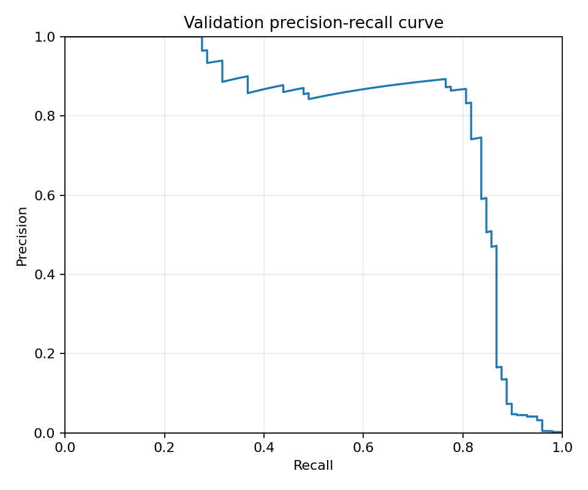
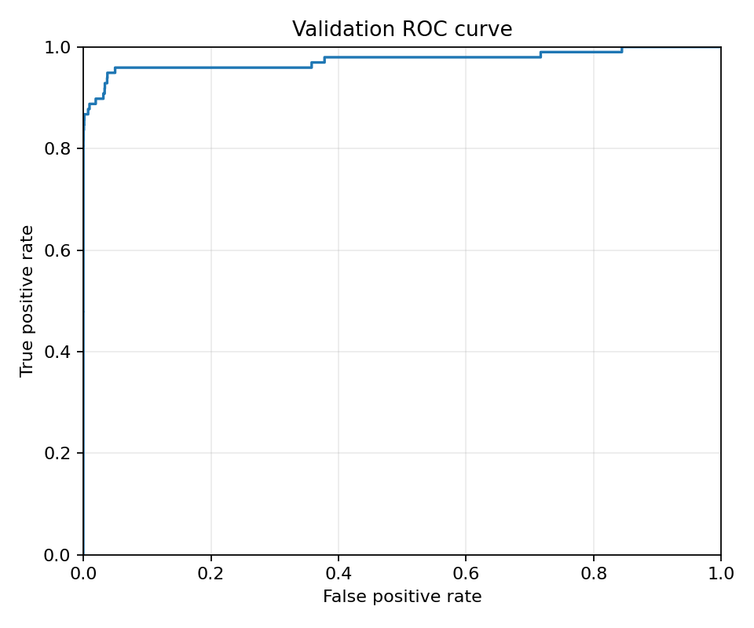

# Лабораторна робота 2. Поріг рішення під асиметричну ціну помилок

## Запуск та дані

Набір даних: [Credit Card Fraud Detection на Kaggle](https://www.kaggle.com/datasets/mlg-ulb/creditcardfraud). Файл `creditcard.csv` потрібно завантажити локально і покласти поруч або вказати шлях до нього. Сам CSV-файл до репозиторію не додається.

Для роботи потрібен Python 3.12 та `uv`. Запуск із кореня проєкту:

```powershell
# Навчання моделі та збереження прогнозів
uv run --python 3.12 --with-requirements Lab2/requirements.txt python Lab2/lab2.py train --csv creditcard.csv --out Lab2/artifacts

# Аналіз збережених прогнозів без повторного навчання
uv run --python 3.12 --with-requirements Lab2/requirements.txt python Lab2/lab2.py analyze --out Lab2/artifacts
```

Також можна виконати повний цикл однією командою: `python Lab2/lab2.py run --csv creditcard.csv --out Lab2/artifacts`.

Команда `train` навчає модель один раз і зберігає ваги `model.pt`, розбиття вибірки, сирі значення Amount та не округлені оцінки ймовірностей у папку `Lab2/artifacts/`.
Команда `analyze` працює тільки зі збереженими прогнозами і не потребує повторного навчання чи читання вхідного CSV. Вона рахує матриці плутанини, будує графіки, проводить пошук оптимального порога та аналізує помилки.

Додатково в проєкті є дослідницький ноутбук [lab2_research.ipynb](lab2_research.ipynb). Запустити його можна так:

```powershell
uv run --python 3.12 --with-requirements Lab2/requirements.txt python -m jupyter nbconvert --execute --to notebook --inplace Lab2/lab2_research.ipynb
```

## Підготовка даних та модель

Для навчання моделі використано 29 ознак: `V1`–`V28` та `Amount`. Колонки `Time` та `Class` на вхід моделі не подаються.

Розбиття даних виконано за фіксованою схемою через `train_test_split` з `random_state=0`:
1. Спочатку виділено 40% тимчасових даних зі стратифікацією за класом (залишається 60% train).
2. Потім тимчасові дані поділено навпіл (по 20% на validation і test) також зі стратифікацією.
3. Усі індекси всередині кожного спліту відсортовано, щоб зберегти вихідний порядок рядків з CSV.

| Частина | Кількість об'єктів | Шахрайських транзакцій | Частка шахрайств |
|---|---:|---:|---:|
| Train | 170 884 | 295 | 0,172632% |
| Validation | 56 961 | 98 | 0,172048% |
| Test | 56 962 | 99 | 0,173800% |

Стандартизація `StandardScaler` навчена тільки на тренувальній вибірці (train), після чого застосована до validation та test. Обчислювати середнє і дисперсію на всьому датасеті не можна, бо це призвело б до витоку даних (data leakage) з валідаційної та тестової вибірок. Масиви перетворено у `float32`. Класи штучно не балансувалися.

Архітектура моделі: `Linear(29, 32) -> ReLU -> Linear(32, 1)`.
Функція втрат: `BCEWithLogitsLoss` (середнє за пакетом, без ваг).
Оптимізатор: `Adam`, learning rate = 0.001.
Навчання: 12 епох, розмір батчу 1024, останній неповний батч враховується. Перед ініціалізацією встановлено `torch.manual_seed(0)`. Для перемішування батчів на кожній епосі використовується окремий `np.random.default_rng(0)`.

Після 12-ї епохи модель переводиться в режим `eval()` і без розрахунку градієнтів обчислюються ймовірності $s_i = \text{sigmoid}(z_i)$.

## Вибір порога на валідації

Транзакція вважається шахрайською, якщо $s_i \ge t$.
- $TP$ - виявлені шахрайства.
- $FP$ - легітимні транзакції, на які спрацювала тривога.
- $FN$ - пропущені шахрайства.
- $TN$ - правильно пропущені легітимні транзакції.

Вартість помилок рахується за формулою:
$$C(t) = 10 \cdot FN(t) + FP(t)$$
Сире значення Amount у розрахунок вартості не входить.

Метрики:
$$\text{precision} = \frac{TP}{TP + FP}, \quad \text{recall} = \frac{TP}{TP + FN}$$
Якщо знаменник дорівнює нулю, метрика є невизначеною ($0/0$), оскільки не було жодного позитивного прогнозу (для precision) або у вибірці немає позитивних об'єктів (для recall).





ROC-AUC на валідації дорівнює **0,973774**. Проте високий ROC-AUC не гарантує низької вартості помилок чи високого precision. ROC-крива оцінює якість ранжування за всіма можливими порогами симетрично і спирається на FPR ($FP / N$). Оскільки легітимних транзакцій у вибірці понад 99.8%, навіть крихітний відсоток хибних тривог дає велику абсолютну кількість $FP$, що сильно знижує precision і не враховує 10-кратний штраф за $FN$.

Пошук оптимального порога реалізовано за $O(n \log n)$ через сортування оцінок та кумулятивні суми позитивних міток (`np.cumsum`). Усі однакові оцінки переходять поріг одночасно в межах однієї групи. Кандидатами є всі унікальні значення оцінок та поріг $+\infty$ (усі прогнози негативні). При наявності кількох порогів з однаковою мінімальною вартістю обирається найбільший із них.

| Правило | Поріг | TP | FP | FN | TN | C |
|---|---:|---:|---:|---:|---:|---:|
| Стандартний поріг | 0,5 | 72 | 9 | 26 | 56 854 | 269 |
| Мінімум вартості | 0,037034064531326294 | 82 | 28 | 16 | 56 835 | **188** |
| Усі негативні | +∞ | 0 | 0 | 98 | 56 863 | 980 |

Повна таблиця кандидатів збережена у файлі `artifacts/validation_candidates.csv`.

## Перевірка пошуку на трьох малих наборах

Для перевірки коректності швидкого алгоритму реалізовано незалежний прямий перебір для трьох тестових наборів:
- **Набір A**: $s = [0.9, 0.7, 0.7, 0.4, 0.2, 0.1]$, $y = [0, 1, 0, 1, 0, 0]$
- **Набір B**: $s = [0.9, 0.6, 0.3]$, $y = [0, 0, 0]$
- **Набір C**: $s = [0.8, 0.5 \times 11, 0.2]$, $y = [1, 1, 0 \times 10, 0]$

Результати розрахунків:

| Набір | Поріг | TP | FP | FN | TN | C |
|---|---:|---:|---:|---:|---:|---:|
| A | +∞ | 0 | 0 | 2 | 4 | 20 |
| A | 0,9 | 0 | 1 | 2 | 3 | 21 |
| A | 0,7 | 1 | 2 | 1 | 2 | 12 |
| A | **0,4** | 2 | 2 | 0 | 2 | **2** |
| A | 0,2 | 2 | 3 | 0 | 1 | 3 |
| A | 0,1 | 2 | 4 | 0 | 0 | 4 |
| B | **+∞** | 0 | 0 | 0 | 3 | **0** |
| B | 0,9 | 0 | 1 | 0 | 2 | 1 |
| B | 0,6 | 0 | 2 | 0 | 1 | 2 |
| B | 0,3 | 0 | 3 | 0 | 0 | 3 |
| C | +∞ | 0 | 0 | 2 | 11 | 20 |
| C | **0,8** | 1 | 0 | 1 | 11 | **10** |
| C | 0,5 | 2 | 10 | 0 | 1 | **10** |
| C | 0,2 | 2 | 11 | 0 | 0 | 11 |

Усі лічильники та обрані пороги для швидкого та прямого алгоритмів збіглися на 100%:
- Набір A перевіряє спільний перехід при однакових оцінках: обидва елементи з оцінкою 0.7 змінюють стан одночасно.
- Набір B перевіряє вибірку без позитивних міток: оптимальним є поріг $+\infty$, коли модель взагалі не генерує тривог і $C = 0$.
- Набір C перевіряє розв'язання нічиєї: пороги 0.8 та 0.5 дають однакову вартість $C = 10$. За правилом обирається більший поріг **0.8**, оскільки він робить менше хибних тривог.

## Оцінка на тестовій вибірці та аналіз помилок

Оптимальний поріг $t^* = 0,037034064531326294$, знайдений на validation, застосовано до test без змін.

Результати на test:
- Матриця плутанини: $TP = 80$, $FP = 35$, $FN = 19$, $TN = 56 828$.
- Вартість: $C = 225$.
- Точність (precision): $0,695652$.
- Повнота (recall): $0,808081$.

Для порівняння, при стандартному порозі 0.5 на тесті було б: $TP = 71$, $FP = 8$, $FN = 28$, $TN = 56 855$, $C = 288$. Зниження порога дозволило зменшити загальну вартість з 288 до 225.

Перші 5 хибнопозитивних (FP) та перші 5 хибнонегативних (FN) прикладів за номером рядка в CSV (індексація з 0):

| Рядок CSV | Тип помилки | Мітка | Оцінка s | Amount | s − t* |
|---:|:---:|---:|---:|---:|---:|
| 460 | FP | 0 | 0,186726 | 2,00 | +0,149692 |
| 2961 | FP | 0 | 0,069137 | 2,49 | +0,032103 |
| 10783 | FP | 0 | 0,964668 | 89,99 | +0,927634 |
| 13405 | FP | 0 | 0,928222 | 89,99 | +0,891188 |
| 13617 | FP | 0 | 0,918403 | 89,99 | +0,881369 |
| 10497 | FN | 1 | 0,010822 | 3,79 | −0,026212 |
| 52521 | FN | 1 | 0,006813 | 105,99 | −0,030222 |
| 55401 | FN | 1 | 0,005848 | 1,00 | −0,031186 |
| 91671 | FN | 1 | 0,000526 | 290,18 | −0,036508 |
| 93486 | FN | 1 | 0,018775 | 0,00 | −0,018259 |

У таблиці видно, що суми транзакцій Amount для FP варіюються від 2.00 до 89.99, а для FN - від 0.00 до 290.18. Є приклади як дуже близькі до порога (наприклад, FN з відхиленням -0.018 або FP з відхиленням +0.032), так і дуже далекі (FP з оцінками понад 0.9).

Чи можна за 10 прикладами судити про причину помилок моделі? Ні, не можна. Десять прикладів - це занадто мала і нерепрезентативна вибірка, до того ж відібрана просто за початковим порядком рядків CSV. Крім того, модель приймає рішення на основі 29 ознак (включаючи компоненти PCA $V_1$–$V_{28}$), тому аналізувати лише Amount недостатньо для виявлення системних закономірностей.

## Висновки

1. **Що змінив вибір порога:** Сама модель і її ваги залишилися незмінними, змінилося лише правило прийняття рішень ($s_i \ge t^*$). Оскільки пропуск шахрайства ($FN$) у 10 разів дорожчий за хибну тривогу ($FP$), поріг суттєво змістився вниз (з 0.5 до приблизно 0.037).
2. **Ціна рішення:** Зниження порога дозволило зловити більше шахрайств ціною збільшення кількості хибних тривог. На валідації вдалося зменшити кількість $FN$ на 10 прикладів (з 26 до 16) ціною 19 додаткових $FP$ (вартість впала з 269 до 188). На тесті ми додатково виявили 9 шахрайств (кількість $FN$ зменшилася з 28 до 19) ціною 27 додаткових $FP$ (вартість зменшилася з 288 до 225).
3. **Чому виграш на validation не гарантує однакового результату на test:** Поріг підбирався під конкретну валідаційну вибірку. Через випадковий шум у даних, обмежений розмір вибірки та можливі локальні флуктуації в розподілі оцінок, отриманий на валідації виграш є оптимістичною оцінкою. На тесті баланс між $FN$ та $FP$ дещо змінився (вартість вийшла 225 замість 188), проте загальний ефект оптимізації порога залишився суттєвим.

## Джерела та інструменти

- Набір даних: [Credit Card Fraud Detection на Kaggle](https://www.kaggle.com/datasets/mlg-ulb/creditcardfraud).
- Використані бібліотеки: NumPy, pandas, scikit-learn, PyTorch, Matplotlib (версії зафіксовано у `requirements.txt`).
