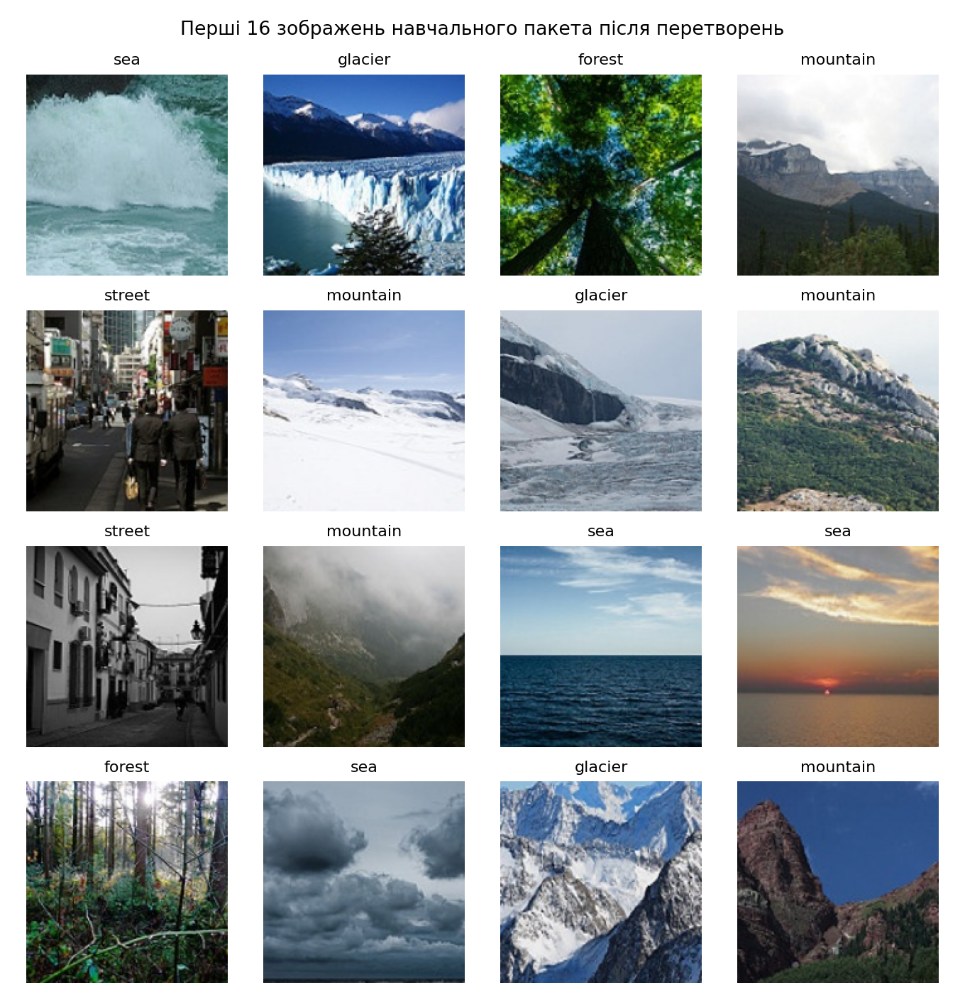
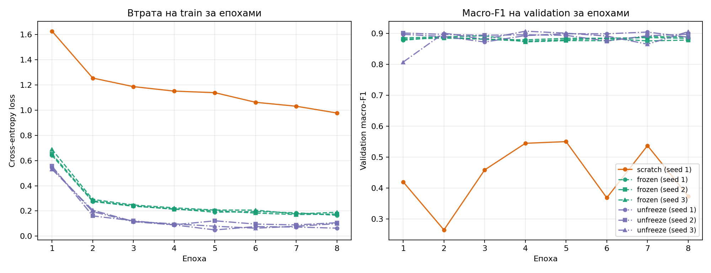
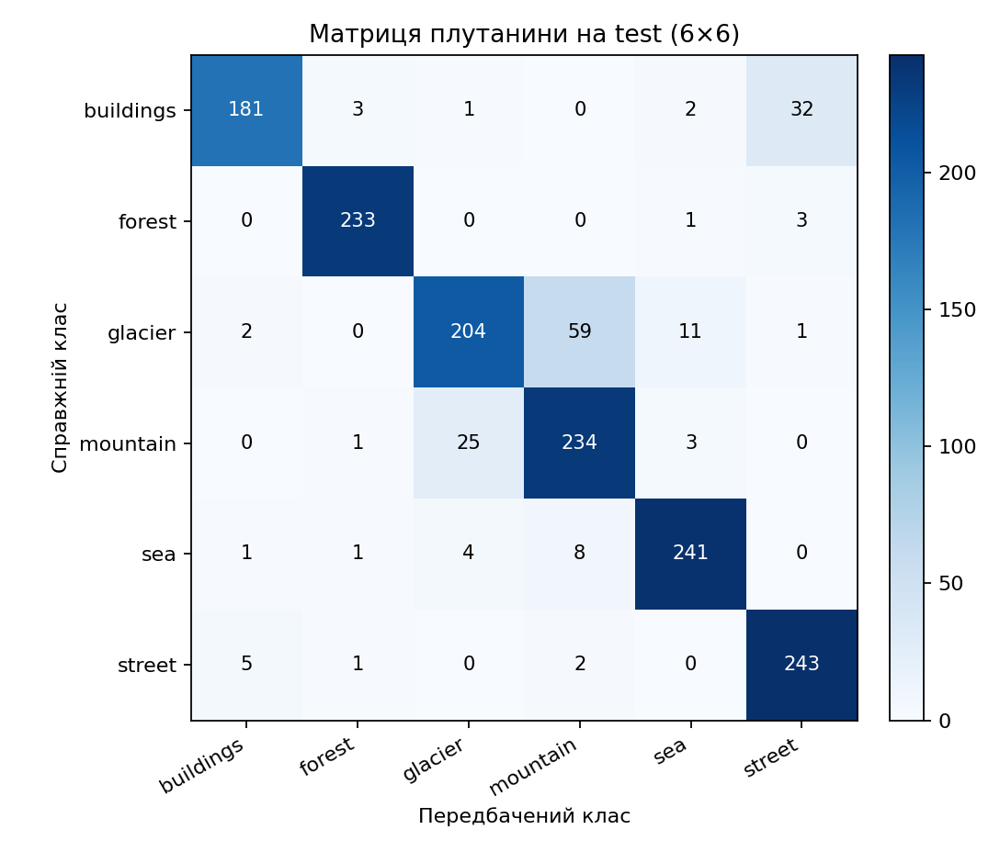
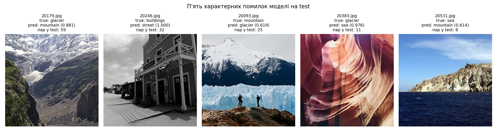

# Лабораторна робота 3. Обчислювальний експеримент і трансферне навчання

## Запуск та дані

Набір даних: [Intel Image Classification на Kaggle](https://www.kaggle.com/datasets/puneet6060/intel-image-classification). Після розпакування архіву локальна тека має містити підтеки `seg_train/seg_train/<клас>/*.jpg` (14 034 зображення, включаючи 55 зображень нестандартної висоти, які вирівнюються перетвореннями без відкидання) та `seg_test/seg_test/<клас>/*.jpg` (3 000 зображень); тека `seg_pred` не використовується. Сам набір даних до репозиторію не додається.

Для роботи потрібен Python 3.12 та `uv`. Запуск із кореня репозиторію:

```powershell
# Поділ даних, перевірки пунктів 1–2, сім запусків навчання та вибір моделі за validation
uv run --python 3.12 --with-requirements Lab3/requirements.txt python Lab3/lab3.py train --data intel-image-classification --out Lab3

# Перевірка журналів, розклад ефектів та одноразова оцінка вибраної моделі на test (CPU)
uv run --python 3.12 --with-requirements Lab3/requirements.txt python Lab3/lab3.py analyze --data intel-image-classification --out Lab3
```

- **Команда `train`** будує детермінований поділ [`split.csv`](split.csv), виконує всі донавчальні перевірки пунктів 1–2 (зберігаючи їх у [`pretrain_checks.json`](pretrain_checks.json)), послідовно проводить рівно сім запусків протоколу зі збереженням журналів `run.json` і валідаційних логітів `val_logits.npy` (`1498 × 6`) у `Lab3/runs/<режим>_seed<зерно>/`, після чого виключно за показниками `validation` обирає найкращу модель і зберігає її у [`lab3_model.pt`](lab3_model.pt) (44,76 МБ — безпосередньо в репозиторії в межах ліміту GitHub 100 МБ). Частина `test` під час виконання `train` не відкривається й не використовується. Повний цикл семи запусків на CPU зайняв **3 800,49 с (63 хв 20 с)**.
- **Команда `analyze`** виконується приблизно за **15 с** без повторного навчання: вона звіряє контрольний хеш `SHA-256` поточного `split.csv` з усіма сімома журналами, перевіряє точний збіг `macro-F1` зі збереженими `val_logits.npy`, будує криві навчання, обчислює розклад ефектів, перевіряє відповідність `lab3_model.pt` правилу відбору і один раз на CPU оцінює вибрану модель на `test` (зведення також дублюється в [`analysis_summary.json`](analysis_summary.json)).

Примітка щодо поля `git_commit` у журналах `runs/*/run.json`: усі сім запусків виконано в єдиному стані коду поверх базового коміту `f81c35f72bfb880ae1276dd3b3f4ce188382b0a3` (`"git_uncommitted_changes": true`) до фінального коміту результатів ЛР3; контрольний хеш `split.csv` однаковий у всіх семи журналах (`b827abdece5aaebda23cfa5129c99f8aecbdef3ef27dce5c9ae53b88aab45d46`).

---

## 1. Перевірки до навчання

### Контроль поділу (`split.csv`)

Для кожного класу у фіксованому порядку `buildings, forest, glacier, mountain, sea, street` імена файлів відсортовано як рядки (`sorted()`). Першим генератором `np.random.default_rng(0)` для всіх класів по черзі взято `idx[:200]` після `rng.shuffle(np.arange(n_k))` у `seg_train` (разом 1200 зображень `train`). Другим незалежним генератором `np.random.default_rng(0)` для всіх класів `seg_test` виконано поділ за `cut = n_k // 2` на `validation` (1498 зображень) і `test` (1502 зображення).

| Клас | train (кількість / сума імен) | validation (кількість / сума імен) | test (кількість / сума імен) | Збіг із контролем |
|---|---:|---:|---:|:---:|
| `buildings` | 200 / 1 996 761 | 218 / 4 837 323 | 219 / 4 837 559 | так |
| `forest` | 200 / 2 032 625 | 237 / 5 276 962 | 237 / 5 291 326 | так |
| `glacier` | 200 / 2 183 923 | 276 / 6 135 652 | 277 / 6 157 250 | так |
| `mountain` | 200 / 1 950 345 | 262 / 5 789 535 | 263 / 5 849 765 | так |
| `sea` | 200 / 1 987 613 | 255 / 5 655 068 | 255 / 5 668 011 | так |
| `street` | 200 / 1 841 817 | 250 / 5 541 845 | 251 / 5 547 533 | так |
| **Разом** | **1200 / 11 993 084** | **1498 / 33 236 385** | **1502 / 33 351 444** | **так** |

Усі 18 клітинок та підсумкові суми збігаються з контрольною таблицею умови. Усі 4200 імен файлів у `split.csv` унікальні — жодне зображення не потрапило одночасно у дві частини (`no_overlap = true`).

### Пакет після перетворень

Перші 16 зображень навчального пакета у тому вигляді, в якому їх отримує мережа (`RandomResizedCrop(160, scale=(0.7, 1.0))` → `RandomHorizontalFlip()` → `ToTensor()` → `Normalize(mean, std)`), з оберненим нормуванням для візуалізації та підписаною міткою класу:



### Початкова втрата $L_0$

Для нових екземплярів моделі зі зерном `seed = 1` після виклику `set_train_mode` під `torch.no_grad()` до жодного кроку оптимізатора на першому пакеті навчального завантажувача (`batch_size = 32`) отримано:

| Режим / теоретичний орієнтир | Початкова втрата $L_0$ | Різниця $L_0 - \ln 6$ |
|---|---:|---:|
| Рівномірний розподіл $\ln 6$ | 1,791759 | 0,000000 |
| `scratch` (`seed = 1`) | 2,047885 | +0,256125 |
| `frozen` (`seed = 1`) | 1,924394 | +0,132635 |

**Пояснення відхилення від $\ln 6 \approx 1,7918$.** Втрата $\ln 6$ досягається лише тоді, коли всі шість вихідних логітів однакові й softmax приписує кожному класу ймовірність рівно $1/6$. Оскільки нова голова `Linear(512, 6)` ініціалізується ненульовими рівномірними вагами та зміщеннями $\mathcal{U}(-1/\sqrt{512}, 1/\sqrt{512})$ і приймає ненульовий вектор ознак з передостаннього шару, початкові логіти мають ненульовий випадковий розкид між шістьма класами. Через строгу опуклість функції $\log \sum_{c=1}^{6} e^{z_c}$ (за нерівністю Єнсена $\mathbb{E}[\log \sum_c e^{z_c}] > \log 6$ при нульовому середньому та ненульовій дисперсії логітів) випадкова нерівномірність початкових ймовірностей закономірно підвищує початкову перехресну ентропію понад $\ln 6$. У режимі `scratch` відхилення більше (`2,0479` проти `1,9244`), тому що шари `BatchNorm2d` у режимі `train()` нормують випадкові ознаки кожного каналу до одиничної дисперсії перед фінальним усередненням, тоді як у `frozen` ознаки після `ReLU` та `AdaptiveAvgPool2d` з кістяка ImageNet більш розріджені й менші за дисперсією.

---

## 2. Перевірка режимів навчання

Перевірки цього розділу виконано на окремих нових екземплярах моделі (`seed = 1`), які не оцінювалися на `validation`, не зберігалися і не входили до таблиці семи запусків.

### Параметри та склад груп `AdamW`

| Режим | Ваги кістяка | Усього параметрів (`numel`) | Параметрів із `requires_grad=True` | Групи `AdamW` (кількість параметрів, `lr`, `weight_decay`) | Параметри з `requires_grad=False` в оптимізаторі | Збіг із умовою |
|---|---|---:|---:|---|:---:|:---:|
| `scratch` | випадкові (`None`) | 11 179 590 | 11 179 590 | Група 1 (уся мережа): `11 179 590`, `lr = 3·10⁻³`, `wd = 10⁻⁴` | ні | так |
| `frozen` | `IMAGENET1K_V1` | 11 179 590 | 3 078 | Група 1 (`fc`): `3 078`, `lr = 3·10⁻³`, `wd = 10⁻⁴` | ні | так |
| `unfreeze` | `IMAGENET1K_V1` | 11 179 590 | 8 396 806 | Група 1 (`fc`): `3 078`, `lr = 3·10⁻³`, `wd = 10⁻⁴`; Група 2 (`layer4`): `8 393 728`, `lr = 3·10⁻⁴`, `wd = 10⁻⁴` | ні | так |

У режимі `unfreeze` блоку `layer4` призначено вдесятеро меншу швидкість навчання (`3·10⁻⁴` проти `3·10⁻³` для `fc`), оскільки нова голова `fc` стартує з випадкових ваг і потребує великого кроку для швидкого узгодження з ознаками, тоді як `layer4` вже містить сформовані ознаки ImageNet: великий крок на перших ітераціях зруйнував би їх шумними градієнтами від ще не навченої голови.

### Що змінюється під час навчання за 5 кроків (`set_train_mode`)

Точна перевірка (`torch.equal` без допуску) для кожного модуля верхнього рівня після 5 кроків оптимізатора на перших 5 пакетах `train`:

| Режим | Модуль | Параметри змінилися | Ковзні статистики BN змінилися | Збігається з очікуваним |
|---|---|:---:|:---:|:---:|
| `frozen` | `conv1` | ні | немає BN | так |
| `frozen` | `bn1` | ні | ні | так |
| `frozen` | `layer1` | ні | ні | так |
| `frozen` | `layer2` | ні | ні | так |
| `frozen` | `layer3` | ні | ні | так |
| `frozen` | `layer4` | ні | ні | так |
| `frozen` | `fc` | так | немає BN | так |
| `unfreeze` | `conv1` | ні | немає BN | так |
| `unfreeze` | `bn1` | ні | ні | так |
| `unfreeze` | `layer1` | ні | ні | так |
| `unfreeze` | `layer2` | ні | ні | так |
| `unfreeze` | `layer3` | ні | ні | так |
| `unfreeze` | `layer4` | так | так | так |
| `unfreeze` | `fc` | так | немає BN | так |

### Дослід із навмисною помилкою (`model.train()` замість `set_train_mode` для `frozen`)

**Прогноз до запуску.** Якщо в режимі `frozen` викликати звичайний `model.train()` замість `set_train_mode`, то:
1. Параметри (ваги та зміщення) замороженого кістяка `conv1`, `bn1`, `layer1`–`layer4` **не зміняться**, бо для них виставлено `requires_grad=False` і вони відсутні в групах `AdamW`.
2. Ковзні статистики пакетної нормалізації (`running_mean`, `running_var`, а також `num_batches_tracked`) у всіх BN-модулях кістяка (`bn1`, `layer1`–`layer4`) **зміняться**.
3. Із самої кривої втрати на `train` ця помилка **не буде помітною**: у стані `training=True` шари `BatchNorm2d` нормують кожен пакет за середнім і дисперсією поточного пакета й взагалі не використовують `running_mean` / `running_var` для обчислення виходу чи градієнтів; псування ковзних статистик проявиться лише під час переходу в `model.eval()` на `validation` / `test`, коли замість узгоджених статистик ImageNet підставлятимуться зміщені й шумні оцінки з малих пакетів по 32 зображення нової задачі.

**Результат після 5 кроків і зіставлення з прогнозом:**

| Режим (помилковий) | Модуль | Параметри змінилися | Ковзні статистики BN змінилися | Збіг із правильним `frozen` |
|---|---|:---:|:---:|:---:|
| `frozen` (`model.train()`) | `conv1` | ні | немає BN | так |
| `frozen` (`model.train()`) | `bn1` | ні | **так** | ні |
| `frozen` (`model.train()`) | `layer1` | ні | **так** | ні |
| `frozen` (`model.train()`) | `layer2` | ні | **так** | ні |
| `frozen` (`model.train()`) | `layer3` | ні | **так** | ні |
| `frozen` (`model.train()`) | `layer4` | ні | **так** | ні |
| `frozen` (`model.train()`) | `fc` | так | немає BN | так |

У шарі `layer1.0.bn1` максимальна абсолютна зміна ковзних статистик за 5 кроків становила:
- $\max \lvert \Delta \text{running\_mean} \rvert = \mathbf{0,092836}$;
- $\max \lvert \Delta \text{running\_var} \rvert = \mathbf{0,120314}$.

Результат на 100% підтвердив прогноз:
- **Чому `requires_grad=False` не захищає `running_mean` і `running_var`:** ці тензори зареєстровані в модулі як буфери (`register_buffer`), а не як `nn.Parameter`. Вони оновлюються не оптимізатором за градієнтом, а безпосередньо всередині `BatchNorm2d.forward()` за формулою експоненційного ковзного середнього (`momentum = 0.1`), якщо `self.training == True`. Єдиний спосіб заморозити їх у PyTorch — перевести відповідні BN-модулі в `.eval()`.
- **Чому для `layer4` у режимі `unfreeze` оновлення BN-статистик правильне:** у `unfreeze` ваги згорток `layer4` змінюються на кожному кроці оптимізатора, через що змінюються середнє та масштаб активацій на їхньому виході; якби буфери BN залишалися зафіксованими від ImageNet, під час `model.eval()` виникало б неузгоджене нормування оновлених ознак.

---

## 3. Сім запусків за протоколом

Усі сім запусків виконано у `float32` на процесорі `AMD Ryzen 5 6600H with Radeon Graphics` (`cpu (AMD64 Family 25 Model 68 Stepping 1, AuthenticAMD)`, Python `3.12.13`, PyTorch `2.8.0+cpu`, torchvision `0.23.0+cpu`). Бюджет кожного запуску — рівно 8 епох по $\lceil 1200 / 32 \rceil = 38$ пакетів (останній пакет епохи містить 16 зображень), разом **304 кроки оптимізатора**; сумарний час семи запусків становив **3 800,49 с (63,34 хв)**.

### Підсумкова таблиця семи запусків (після 8-ї епохи)

| # | Режим | Зерно | Втрата train, епоха 8 | macro-F1 validation, епоха 8 | Час навчання, с |
|---:|---|---:|---:|---:|---:|
| 1 | `scratch` | 1 | 0,977186 | 0,373342 | 863,35 |
| 2 | `frozen` | 1 | 0,165453 | 0,884201 | 402,81 |
| 3 | `frozen` | 2 | 0,175656 | 0,878500 | 469,38 |
| 4 | `frozen` | 3 | 0,189583 | 0,888596 | 406,73 |
| 5 | `unfreeze` | 1 | 0,063450 | 0,887681 | 615,13 |
| 6 | `unfreeze` | 2 | 0,106692 | 0,897336 | 507,73 |
| 7 | `unfreeze` | 3 | 0,099768 | **0,905687** | 535,36 |



### Повна динаміка за епохами зі збережених журналів `runs/*/run.json`

Втрата на `train` за епохами 1–8:

| # | Запуск | Епоха 1 | Епоха 2 | Епоха 3 | Епоха 4 | Епоха 5 | Епоха 6 | Епоха 7 | Епоха 8 |
|---:|---|---:|---:|---:|---:|---:|---:|---:|---:|
| 1 | `scratch_seed1` | 1,6267 | 1,2547 | 1,1865 | 1,1511 | 1,1386 | 1,0623 | 1,0309 | 0,9772 |
| 2 | `frozen_seed1` | 0,6405 | 0,2748 | 0,2374 | 0,2167 | 0,1899 | 0,1954 | 0,1851 | 0,1655 |
| 3 | `frozen_seed2` | 0,6516 | 0,2804 | 0,2401 | 0,2134 | 0,2025 | 0,1831 | 0,1715 | 0,1757 |
| 4 | `frozen_seed3` | 0,6880 | 0,2912 | 0,2474 | 0,2249 | 0,2070 | 0,2066 | 0,1761 | 0,1896 |
| 5 | `unfreeze_seed1` | 0,5435 | 0,1944 | 0,1144 | 0,0895 | 0,0494 | 0,0758 | 0,0723 | 0,0634 |
| 6 | `unfreeze_seed2` | 0,5557 | 0,1608 | 0,1220 | 0,0901 | 0,1217 | 0,0958 | 0,0890 | 0,1067 |
| 7 | `unfreeze_seed3` | 0,5306 | 0,2059 | 0,1167 | 0,0976 | 0,0786 | 0,0630 | 0,0784 | 0,0998 |

`macro-F1` на `validation` за епохами 1–8:

| # | Запуск | Епоха 1 | Епоха 2 | Епоха 3 | Епоха 4 | Епоха 5 | Епоха 6 | Епоха 7 | Епоха 8 |
|---:|---|---:|---:|---:|---:|---:|---:|---:|---:|
| 1 | `scratch_seed1` | 0,4195 | 0,2642 | 0,4583 | 0,5445 | 0,5499 | 0,3681 | 0,5370 | 0,3733 |
| 2 | `frozen_seed1` | 0,8781 | 0,8885 | 0,8810 | 0,8792 | 0,8842 | 0,8846 | 0,8864 | 0,8842 |
| 3 | `frozen_seed2` | 0,8816 | 0,8849 | 0,8816 | 0,8748 | 0,8794 | 0,8838 | 0,8759 | 0,8785 |
| 4 | `frozen_seed3` | 0,8858 | 0,8890 | 0,8925 | 0,8726 | 0,8767 | 0,8766 | 0,8900 | 0,8886 |
| 5 | `unfreeze_seed1` | 0,8970 | 0,8901 | 0,8723 | 0,8930 | 0,8989 | 0,8988 | 0,9045 | 0,8877 |
| 6 | `unfreeze_seed2` | 0,9014 | 0,8967 | 0,8943 | 0,8957 | 0,8938 | 0,8753 | 0,8927 | 0,8973 |
| 7 | `unfreeze_seed3` | 0,8074 | 0,9011 | 0,8813 | 0,9073 | 0,9009 | 0,8916 | 0,8651 | **0,9057** |

---

## 4. Розклад ефектів

Середнє та розмах за трьома зернами для кожного трансферного режиму ($r \in \{\text{frozen}, \text{unfreeze}\}$):

$$\bar{F}_r = \frac{1}{3}\sum_{s=1}^{3} F_{r,s}, \qquad R_r = \max_s F_{r,s} - \min_s F_{r,s}, \qquad R = \max(R_{\text{frozen}}, R_{\text{unfreeze}}).$$

Ефект попереднього навчання, ефект розморожування та їхня сума (повний виграш трансферу відносно навчання з нуля):

$$\Delta_{\text{pre}} = \bar{F}_{\text{frozen}} - F_{\text{scratch},1}, \qquad \Delta_{\text{unf}} = \bar{F}_{\text{unfreeze}} - \bar{F}_{\text{frozen}}, \qquad \Delta_{\text{pre}} + \Delta_{\text{unf}} = \bar{F}_{\text{unfreeze}} - F_{\text{scratch},1}.$$

| Величина | Значення | Вердикт за правилом $\lvert\Delta\rvert \le R$ / $\lvert\Delta\rvert > R$ |
|---|---:|---|
| $\bar{F}_{\text{frozen}}, \; R_{\text{frozen}}$ | 0,883766; 0,010095 | середнє `0,8838`, розмах `0,0101` (`0,8785`…`0,8886`) |
| $\bar{F}_{\text{unfreeze}}, \; R_{\text{unfreeze}}$ | 0,896901; 0,018005 | середнє `0,8969`, розмах `0,0180` (`0,8877`…`0,9057`) |
| $R$ | 0,018005 | консервативний поріг шуму між запусками |
| $\Delta_{\text{pre}}$ | +0,510424 | $\lvert\Delta_{\text{pre}}\rvert = 0,5104 > R = 0,0180$: **ефект вартий перевірки, але не доведений** |
| $\Delta_{\text{unf}}$ | +0,013136 | $\lvert\Delta_{\text{unf}}\rvert = 0,0131 \le R = 0,0180$: **різниця не відрізняється від розкиду: результату немає** |
| $\Delta_{\text{pre}} + \Delta_{\text{unf}}$ | +0,523559 | повний виграш трансферу відносно `scratch` |

### Відповіді на контрольні питання до розкладу ефектів

1. **Що саме змінює зерно в кожному з трьох режимів і чому розкид у `frozen` і `unfreeze` відрізняється.**
   - У режимі `scratch` зерно визначає випадкову ініціалізацію всіх `11 179 590` параметрів мережі (і кістяка, і голови `fc`), порядок перемішування пакетів у `DataLoader` та випадкові трансформації (`RandomResizedCrop`, `RandomHorizontalFlip`) на кожному пакеті кожної епохи.
   - У режимах `frozen` та `unfreeze` ваги кістяка фіксовані (`IMAGENET1K_V1`), тому зерно змінює лише випадкову ініціалізацію лінійної голови `fc` (`3 078` параметрів), порядок формування пакетів і випадкові аугментації.
   - Розкид у `frozen` майже вдвічі менший ($R_{\text{frozen}} = 0,010095$ проти $R_{\text{unfreeze}} = 0,018005$), тому що `frozen` розв'язує опуклу задачу мультикласової логістичної регресії поверх незмінних ознак (`3 078` параметрів), де різні траєкторії SGD збігаються до близьких точок. Натомість в `unfreeze` у неопуклому ландшафті спільно змінюються `8 396 806` параметрів (`layer4 + fc`) та ковзні статистики BN на пакетах по 32 зображення, що робить фінальну точку після 8-ї епохи чутливішою до порядку пакетів і початкових градієнтів від голови.
2. **Чому $R$, виміряний на запусках 2–7, не характеризує розкид запуску 1 і чи змінює це висновок щодо $\Delta_{\text{pre}}$.**
   - Для `scratch` виконано лише один запуск, тому його міжзерновий розмах не входить у $R$. Більше того, крива запуску 1 демонструє сильні між-епохові коливання валідаційного `macro-F1`: `0,4195 → 0,2642 → 0,4583 → 0,5445 → 0,5499 → 0,3681 → 0,5370 → 0,3733` (розмах лише між останніми чотирма епохами сягає `0,1818`, що на порядок більше за $R = 0,0180$). При великому сталому `lr = 3·10⁻³` без спадного розкладу кроку та за перерахунку BN у всій мережі оцінка `scratch` у фіксованій 8-й епосі має велику дисперсію. Втім, навіть порівняно з найкращою точкою кривої запуску 1 (`0,5499` на 5-й епосі) перевага `frozen` (`0,8838`) становить `+0,3338` пункту macro-F1, тобто все одно багаторазово перевищує амплітуду коливань `scratch` і не змінює змістовного висновку про домінування попереднього навчання за бюджету 304 кроки.
3. **Чи однаковий бюджет режимів за часом навчання з таблиці.**
   - Бюджет однаковий лише за кількістю кроків оптимізатора (304 кроки), але **різний за фізичним часом роботи CPU**: один запуск `frozen` триває в середньому `426,31 с` (`402,81–469,38 с`), `unfreeze` — `552,74 с` (`507,73–615,13 с`, на `29,7%` довше через зворотний прохід і оновлення ваг у `layer4`), а `scratch` — `863,35 с` (у `2,03` раза довше за `frozen`, бо зворотне поширення похибки проходить крізь усі шари включно з ранніми згортками на великих картах ознак).

---

## 5. Вибір конфігурації і тестова оцінка

### Правило вибору (лише за `validation`)

Середні валідаційні показники за режимами:
- `scratch`: $F_{\text{scratch},1} = 0,373342$
- `frozen`: $\bar{F}_{\text{frozen}} = 0,883766$
- `unfreeze`: $\bar{F}_{\text{unfreeze}} = \mathbf{0,896901}$

Найбільше середнє має режим `unfreeze`, а серед трьох його запусків найбільше значення після 8-ї епохи дав запуск із `seed = 3` ($F_{\text{unfreeze},3} = \mathbf{0,905687}$). Його ваги збережено у [`lab3_model.pt`](lab3_model.pt). Оскільки $\lvert\Delta_{\text{unf}}\rvert = 0,013136 \le R = 0,018005$, **вибір між `frozen` і `unfreeze` визначив шум**; процедура вибору за протоколом від цього не змінювалася.

### Одноразова оцінка на `test` (CPU)

Тестова вибірка оцінюється лише один раз у команді `analyze` після фіксації моделі: якби за результатами `test` змінювали режим, зерно, кількість епох чи гіперпараметри, тестова частина перетворилася б на приховану валідаційну вибірку й давала б оптимістично зміщену оцінку узагальнення.

Підсумкові показники вибраної моделі (`unfreeze`, `seed = 3`) на `test` ($n = 1502$):
- **`macro-F1` на `test`:** **`0,891348`**
- **Частка правильних відповідей (`accuracy`):** $p = 1336 / 1502 = \mathbf{0,889481}$ (166 помилок із 1502 зображень)
- **Стандартна похибка частки правильних відповідей:** $\text{SE}(p) = \sqrt{p(1 - p)/1502} = \mathbf{0,008090}$

Матриця плутанини $6 \times 6$ на `test` (рядки — справжній клас, стовпці — передбачений клас) та покласові метрики:

| Справжній \ Передбачений | `buildings` | `forest` | `glacier` | `mountain` | `sea` | `street` | Разом | Precision | Recall | F1-міра |
|---|---:|---:|---:|---:|---:|---:|---:|---:|---:|---:|
| `buildings` | **181** | 3 | 1 | 0 | 2 | 32 | 219 | 0,9577 | 0,8265 | 0,8873 |
| `forest` | 0 | **233** | 0 | 0 | 1 | 3 | 237 | 0,9749 | 0,9831 | 0,9790 |
| `glacier` | 2 | 0 | **204** | 59 | 11 | 1 | 277 | 0,8718 | 0,7365 | 0,7984 |
| `mountain` | 0 | 1 | 25 | **234** | 3 | 0 | 263 | 0,7723 | 0,8897 | 0,8269 |
| `sea` | 1 | 1 | 4 | 8 | **241** | 0 | 255 | 0,9341 | 0,9451 | 0,9396 |
| `street` | 5 | 1 | 0 | 2 | 0 | **243** | 251 | 0,8710 | 0,9681 | 0,9170 |



### Порівняння `macro-F1` на `test` із $F_{\text{unfreeze},3}$ та вибірковий шум

Тестове значення `macro-F1 = 0,891348` нижче за валідаційне число вибраного запуску $F_{\text{unfreeze},3} = 0,905687$ на **`-0,014339`** (`-1,43` п.п.) і лежить ближче до середнього за трьома зернами $\bar{F}_{\text{unfreeze}} = 0,896901$. Отже, оптимістичне зміщення від вибору максимуму з трьох запусків **видно в наших числах**. Водночас стандартна похибка через скінченність вибірки $n = 1502$ становить $\text{SE}(p) = 0,008090$ (`0,81` в.п.), а стандартна похибка різниці між двома незалежними вибірками близького обсягу (`validation` $1498$ і `test` $1502$) має порядок $\sqrt{2}\cdot 0,008090 \approx 0,0114$. Оскільки випадковий шум скінченності вибірок ($\sim 0,011$) співмірний із самим зміщенням відбору максимуму з трьох зерен ($\sim 0,009$), на іншому поділі зміщення може виявитися непомітним або навіть змінити знак (коли у `test` випадково потраплять трохи однозначніші зображення, ніж у `validation`).

### П'ять характерних помилок на `test`

П'ять найчастіших позадіагональних пар з матриці плутанини та перший за лексикографічним порядком файл `test` у кожній парі:

| Файл | Справжній клас | Передбачений клас | Імовірність передбаченого класу | Кількість таких помилок у test |
|---|---|---|---:|---:|
| `20179.jpg` | `glacier` | `mountain` | 0,881350 | 59 |
| `20246.jpg` | `buildings` | `street` | 1,000000 | 32 |
| `20093.jpg` | `mountain` | `glacier` | 0,619487 | 25 |
| `20383.jpg` | `glacier` | `sea` | 0,976424 | 11 |
| `20531.jpg` | `sea` | `mountain` | 0,614439 | 8 |



Категорія кожної з п'яти помилок:
1. `20179.jpg` (`glacier` → `mountain`): **сцена містить обидва класи** — льодовиковий язик у глибині ущелини оточений великими скелястими гірськими схилами на передньому й задньому планах.
2. `20246.jpg` (`buildings` → `street`): **сцена містить обидва класи** — фасади будівель знято вздовж вулиці з проїжджою частиною та дерев'яним тротуаром на передньому плані.
3. `20093.jpg` (`mountain` → `glacier`): **сцена містить обидва класи** — під засніженою гірською вершиною на передньому плані розташована масивна стіна льодовика.
4. `20383.jpg` (`glacier` → `sea`): **ймовірна помилка розмітки** — на знімку сухий червоно-помаранчевий пісковиковий каньйон без льодовика чи моря, хвилясту шарувату текстуру якого модель віднесла до класу `sea`.
5. `20531.jpg` (`sea` → `mountain`): **сцена містить обидва класи** — морська поверхня займає нижню частину кадру, а високий скелястий гірський берег домінує у верхній частині.

Двостороння плутанина `glacier` ↔ `mountain` сумарно становить `59 + 25 = 84` випадки (понад половину з усіх `166` помилок на `test`) і є об'єктивною властивістю набору Intel Image Classification при однокласовій розмітці багатооб'єктних гірсько-льодовикових сцен; штучно «виправляти» її не потрібно.

---

## 6. Висновок

- **Попередньо навчені ознаки ($\Delta_{\text{pre}}$):** напрям ефекту додатний, величина становить **+0,510424 пункту macro-F1** на `validation` (зростання з $F_{\text{scratch},1} = 0,373342$ до $\bar{F}_{\text{frozen}} = 0,883766$), що у **28,3 раза більше** за поріг розкиду $R = 0,018005$ ($\lvert\Delta_{\text{pre}}\rvert > R$: ефект вартий перевірки, але формально не доведений у межах протоколу з одним зерном `scratch`).
- **Донавчання кістяка `layer4` ($\Delta_{\text{unf}}$):** напрям ефекту додатний, величина становить **+0,013136 пункту macro-F1** на `validation` (зміна з $\bar{F}_{\text{frozen}} = 0,883766$ до $\bar{F}_{\text{unfreeze}} = 0,896901$; на `test` обраний запуск `unfreeze` зі зерном 3 дав `0,891348`), проте $\lvert\Delta_{\text{unf}}\rvert = 0,013136 \le R = 0,018005$ — отже, ця різниця **не відрізняється від розкиду між запусками** (результату немає).
- **Прив'язка до бюджету:** обидва ефекти виміряно за конкретного обчислювального бюджету в **304 кроки оптимізатора** (8 епох по 38 пакетів); з довшим навчанням і спадним розкладом швидкості навчання режим `scratch` міг би скоротити відставання.

Для нової задачі з 200 зображеннями на клас я б обрав режим `frozen`, оскільки його середня якість ($\bar{F}_{\text{frozen}} = 0,8838$) у межах шуму не поступається `unfreeze` ($\lvert\Delta_{\text{unf}}\rvert \le R$), але він дає майже вдвічі менший розкид між запусками ($R_{\text{frozen}} = 0,0101$ проти $R_{\text{unfreeze}} = 0,0180$) і навчається швидше (`426,3 с` проти `552,7 с` на запуск).

## Джерела та інструменти

- Набір даних: [Intel Image Classification на Kaggle](https://www.kaggle.com/datasets/puneet6060/intel-image-classification).
- Завдання до лабораторної роботи та матеріали лекційного курсу.
- Офіційна документація PyTorch, torchvision, NumPy, scikit-learn, Matplotlib, Pillow (версії зафіксовано у [`requirements.txt`](requirements.txt)).
- Генеративні інструменти: OpenAI | ChatGPT & Codex.
